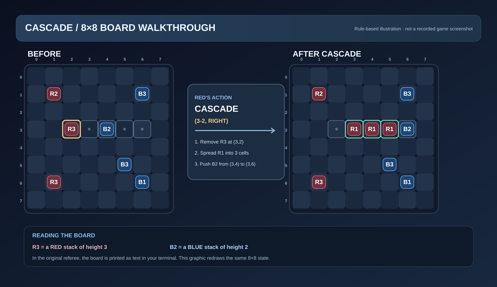
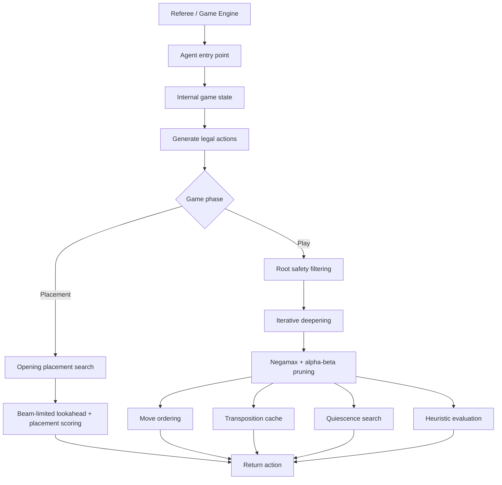
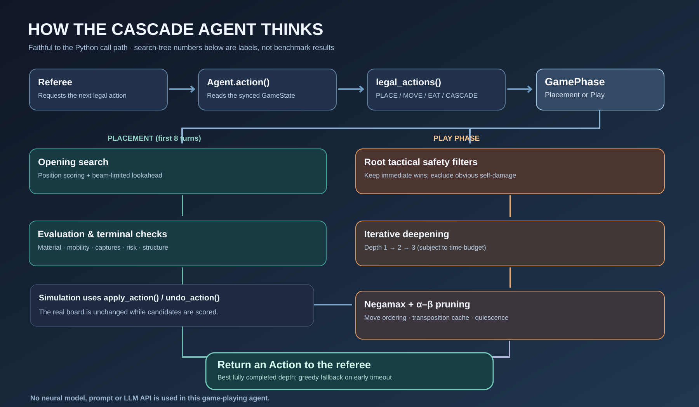

# Cascade AI Agent

A two-player **classical AI game-playing agent** for **Cascade**, implemented in Python with adversarial search, heuristic evaluation, and game-specific tactical safeguards. This is a **search-based decision agent, not an LLM / generative-AI agent**.

This project was originally developed for **COMP30024 Artificial Intelligence** at the University of Melbourne. The repository has been cleaned for portfolio and reproducibility use: personal submission metadata has been removed, while the supplied referee framework is retained so the project can be cloned and run locally.

## Game preview: what you see when it runs

Cascade is an **8 × 8, two-player, turn-based stacking strategy game**. The included `referee` runs the match and **prints the board and moves in a terminal**; the repository does not contain a browser game or a graphical control panel.

- **Red (R)** moves first; **Blue (B)** moves second. `R3` means a red stack containing 3 tokens; `B2` means a blue stack containing 2 tokens; `.` means an empty cell.
- **Placement:** 8 placements in total (4 per player), each introducing a stack of height 3. After the very first placement, a new stack cannot be placed orthogonally adjacent to an opposing stack.
- **Play:** players alternately choose one of the legal moves below. A side wins if the other side has no tokens. At the 300-turn play-phase limit, the side with more tokens wins; the framework also handles draws from threefold repetition and stalemate.

| Action | What it does | Important rule |
| --- | --- | --- |
| `PLACE` | Put a new height-3 stack on an empty cell | Only in placement phase; opponent-adjacency restriction |
| `MOVE` | Move to an adjacent empty cell or merge into an adjacent friendly stack | Four cardinal directions |
| `EAT` | Move onto and capture an adjacent opposing stack | Attacker's height must be ≥ target's height |
| `CASCADE` | Break a stack into single tokens along one direction; occupied cells are pushed | Source stack must have height ≥ 2; pushed stacks can fall off the board |

### Visual board walkthrough



> **About this image:** This is a deliberately constructed, **code-grounded illustration**, not a screenshot or a claim about a particular historical match. The real referee renders its board in terminal text via [`Board.render()`](referee/game/board.py). The SVG redraws a possible play-phase position so the mechanics are easier to understand.

**One concrete move, following the supplied game's rules** (zero-indexed coordinates `row-column`):

1. The red player has `R3` at `(3,2)`; blue has `B2` at `(3,4)`.
2. The candidate action is `CASCADE(3-2, [→])` — a rightward cascade from `(3,2)`.
3. The engine removes the original `R3`, puts red single tokens at `(3,3)`, `(3,4)` and `(3,5)`, and pushes the obstructing `B2` twice: `(3,4) → (3,5) → (3,6)`.
4. The resulting row is `. . . R1 R1 R1 B2 .` for columns `0 … 7`. This is a **rules demonstration**, not a claim that the search actually selected this move in a recorded match.

The original CLI output uses `R3`, `B2` and dots instead of illustrated tiles. Run the commands below to view a **real** match on your terminal.

## Architecture



### Decision pipeline visualized



### How one decision flows through the source code

1. **State synchronization:** [`agent/program.py`](agent/program.py) defines `Agent.action()` and `Agent.update()`. After each referee move, `update()` calls [`GameState.apply_action()`](agent/state.py), keeping the agent's board aligned with the official board.
2. **Legality first:** `action()` calls [`legal_actions()`](agent/movegen.py) to enumerate only actions allowed by the current phase and board. It must return an `Action`, not a move description in free text.
3. **Opening strategy:** While `GamePhase.PLACEMENT`, [`choose_opening_action()`](agent/opening.py) evaluates candidate placements, preselects a beam of promising locations, and simulates short continuations.
4. **Play-phase safety:** [`choose_search_action()`](agent/clean_search.py) applies conservative root filters. For example, a pointless cascade that leaves a valuable stack exposed can be ruled out **before** the main search, as long as legal alternatives remain.
5. **Adversarial search:** [`agent/negamax.py`](agent/negamax.py) uses iterative deepening, move ordering, Negamax and α–β pruning. Each hypothetical move is applied with `board.apply_action(action)` and then rolled back with `board.undo_action()` so the next candidate is evaluated from the **same** position.
6. **Evaluation and fallback:** [`evaluate_board()`](agent/evaluate.py) combines feature scores for unfinished positions; completed games receive terminal scores. A [greedy move](agent/greedy.py) is retained as a legal fallback if the search cannot complete within the time budget.

#### What is the agent evaluating?

For a typical mid-game position, the agent compares competing **legal** actions, for example a quiet `MOVE`, an available `EAT`, and a potentially risky `CASCADE`. The search explores plausible replies by both players; the evaluation rewards useful material, mobility, structure and tactical opportunities and penalizes vulnerabilities. If a branch cannot improve the α–β bound, that branch can be pruned. The **best action from the last fully completed search depth** is returned. This describes the implemented decision process, **not measured scores, a trace from a particular tournament, or an LLM inference**.

Some useful implementation defaults in the current code (not performance claims): main search depth `3`, quiescence depth `1`, transposition-cache entry limit `60,000`, opening root beam-width constant `16` with dynamic adjustments, and separate Red/Blue evaluation weights. All may be adjusted in the source.

## Main Techniques

| Component | Purpose |
| --- | --- |
| **Iterative deepening** | Searches progressively deeper while retaining the best fully completed result. |
| **Negamax + alpha-beta pruning** | Performs adversarial search while pruning branches that cannot affect the final decision. |
| **Move ordering** | Searches promising actions first to improve pruning efficiency. |
| **Transposition cache** | Reuses results for previously explored board states. |
| **Quiescence search** | Extends tactically unstable leaf positions using forcing moves to reduce horizon effects. |
| **Heuristic evaluation** | Scores non-terminal states using material, mobility, tower structure, tactical opportunities, vulnerability, edge risk, centre control, cascade potential, and endgame factors. |
| **Opening search** | Uses a separate placement-phase search with beam-limited lookahead and position-specific scoring. |
| **Tactical safety filters** | Rejects clear one-move losses and selected self-damaging root actions before the main search. |
| **Time-aware fallback** | Keeps a legal greedy fallback and returns the best completed search result when close to the time limit. |

## Repository Structure

```text
cascade_agent/
├── agent/              # Student-developed game-playing agent
│   ├── program.py      # Agent entry point
│   ├── state.py        # Internal board-state handling
│   ├── movegen.py      # Legal action generation
│   ├── opening.py      # Placement-phase search
│   ├── negamax.py      # Main adversarial search
│   ├── evaluate.py     # Heuristic evaluation
│   ├── clean_search.py # Root-level tactical filtering
│   ├── red_safety.py   # Additional first-player tactical safeguards
│   └── greedy.py       # Lightweight fallback policy
├── referee/            # Supplied COMP30024 referee / game framework
├── report.pdf          # Project report
├── README.md
└── .gitignore
```

> `referee/` is the supplied course framework and is included only to make the project directly runnable. The main implementation in this repository is under `agent/`.

## Quick Start

### Requirements

- Python **3.12** recommended
- No additional third-party Python packages are required by the agent itself

### Clone

```bash
git clone https://github.com/Chuan1130/cascade_agent.git
cd cascade_agent
```

### Run an agent-vs-agent game

From the repository root:

```bash
python -m referee agent agent
```

This launches the included referee with two instances of the agent playing against each other.

To see the referee's available command-line options:

```bash
python -m referee --help
```

### Watch the board update after each move

```bash
python -m referee agent agent --wait 0.2 --verbosity 2
```

The referee prints each turn and the updated 8×8 board. Use `--wait -1` to step through manually (press Enter when prompted), or add `--logfile match.log` to save the game action log. `--verbosity 0` prints only the result. These flags are implemented by [`referee/options.py`](referee/options.py).

## Decision Pipeline

### 1. Placement phase

During the opening placement phase, the agent does not use the normal mid-game Negamax search. Instead, it scores candidate placements using factors such as centrality, connectivity, opponent-space restriction, and opening shape, then applies a small lookahead search over a beam-limited candidate set.

### 2. Play phase

Once normal play begins, the agent first generates legal actions and applies conservative root-level safety checks. The remaining actions are passed to iterative-deepening Negamax with alpha-beta pruning.

The search uses:

- previous-depth best-move preference,
- action-ordering memory,
- transposition-table bounds,
- forcing-move quiescence search,
- colour-specific tactical adjustments,
- repetition and endgame handling,
- a deadline-aware early exit.

### 3. Evaluation

At non-terminal search leaves, the evaluation function combines a weighted feature vector. Important signals include:

- token/material advantage,
- number and shape of stacks,
- mobility,
- useful stack height,
- immediate captures,
- vulnerability to capture,
- edge exposure,
- centre control,
- cascade opportunities,
- turn-limit pressure,
- repetition behaviour,
- endgame conversion quality.

Terminal positions bypass the heuristic and receive direct win/loss/draw scores.

## Implementation boundaries and portfolio notes

- **What is authored here:** the `agent/` decision system (entry point, state synchronization, move generation, opening policy, search, evaluation, tactical safety and fallback).
- **What was supplied:** the COMP30024 `referee/` game rules, board rendering, runner and player interface. Do not attribute these framework components to the agent implementation.
- **What is *not* implemented:** there is no large language model, prompt-engineering layer, tool-calling system, browser UI or production service backend.
- **Reproducibility:** `python -m referee agent agent` runs two instances of the agent; saved screenshots and competitive win rates are intentionally **not fabricated**. For a performance claim, run a repeatable experiment with recorded opponents, seeds and results first.

This project demonstrates **Python, adversarial search, state-space exploration, heuristic engineering, constrained decision-making and code-level strategy trade-offs**. For backend/software roles, the transferable aspects are modular architecture, deterministic state transitions, legal input validation, time-budgeted execution and conservative fallbacks.

## Report

The original project report is retained as [`report.pdf`](./report.pdf) for a more detailed discussion of the development process and evaluation.

## Attribution

The **agent implementation** is the project work contained in `agent/`. The **referee/game framework** under `referee/` was supplied for COMP30024 and is retained for local execution and reproducibility.

No licence is asserted here over the supplied course framework.